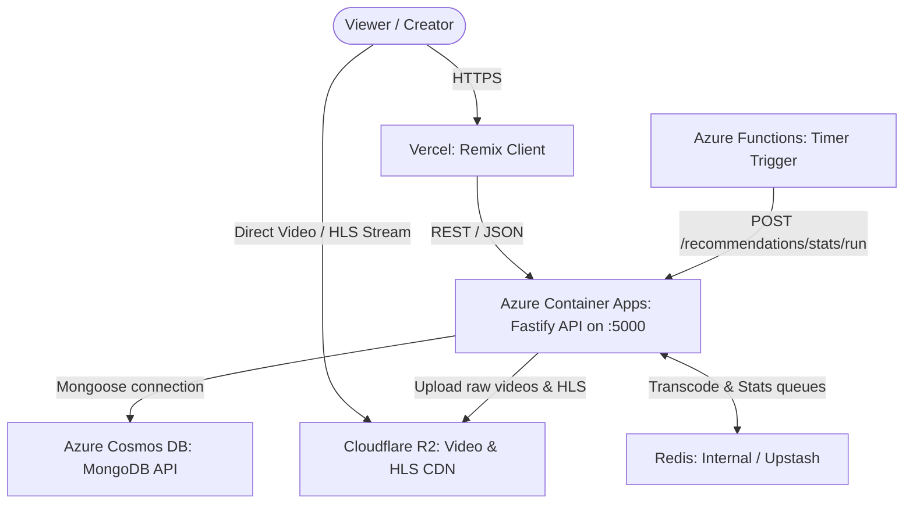

# LokDarpan: Complete Azure + Vercel + Cloudflare R2 Hosting Guide

This guide details how to host LokDarpan using **100% Free-Tier / Zero-Egress cloud infrastructure**:

| Layer | Service | Free Tier Allowance | Purpose |
| :--- | :--- | :--- | :--- |
| **Frontend** | [Vercel](https://vercel.com) | Hobby Tier (Free) | Global edge hosting for Remix Vite client |
| **Backend API** | [Azure Container Apps](https://azure.microsoft.com/services/container-apps/) | 180,000 vCPU-sec, 360,000 GiB-sec, 2M reqs/mo | Containerized Fastify API (`server/Server.js`) |
| **Database** | [Azure Cosmos DB for MongoDB](https://azure.microsoft.com/services/cosmos-db/) | 1,000 RU/s provisioned throughput, 25 GB storage | Managed MongoDB API document database |
| **Background Cron** | [Azure Functions](https://azure.microsoft.com/services/functions/) | 1,000,000 executions/month | Scheduled timer triggers for recommendation stats & reconciler |
| **Media Storage** | [Cloudflare R2](https://www.cloudflare.com/developer-platform/r2/) | 10 GB storage, 1M writes, 10M reads/mo, **$0 egress fees** | Video uploads, HLS playlists (`.m3u8`), `.ts` segments, thumbnails |
| **Cache & Queues**| Internal Container Redis or [Upstash Redis](https://upstash.com) | 10,000 commands/day | BullMQ transcode jobs & feed recommendation caching |

---

## Architecture Flow



---

## 1. Set Up Azure Cosmos DB for MongoDB (Always Free Tier)

Azure provides **1 free Cosmos DB account per subscription** with 1,000 RU/s and 25 GB storage forever.

### Using Azure CLI:
```bash
# 1. Create Resource Group
az group create --name lokdarpan-rg --location centralindia

# 2. Create Cosmos DB account with MongoDB API & Free Tier enabled
az cosmosdb create \
  --name lokdarpan-cosmos \
  --resource-group lokdarpan-rg \
  --kind MongoDB \
  --server-version 4.2 \
  --enable-free-tier true \
  --default-consistency-level Session

# 3. Retrieve Primary Connection String
az cosmosdb keys list --name lokdarpan-cosmos --resource-group lokdarpan-rg --type connection-strings
```

Your `MONGO_URI` will look like:
```text
mongodb://lokdarpan-cosmos:<PRIMARY_KEY>@lokdarpan-cosmos.mongo.cosmos.azure.com:10255/?ssl=true&replicaSet=globaldb&retrywrites=false&maxIdleTimeMS=120000&appName=@lokdarpan-cosmos@
```
> **Note**: LokDarpan's [`database.js`](file:///c:/Users/bhoya/raj/personal/LokDarpan/server/src/config/database.js) automatically appends `/lokdarpan` safely before query parameters and handles Cosmos DB connection lifecycles.

---

## 2. Set Up Cloudflare R2 Storage ($0 Egress Fees Forever)

Cloudflare R2 gives you 10 GB free storage with **zero egress costs**, making it ideal for video platforms.

1. In the **Cloudflare Dashboard**, navigate to **R2**.
2. Click **Create bucket** and name it `lokdarpan-media`.
3. In bucket settings:
   - Under **Public access**, enable **R2.dev subdomain** (or connect a custom domain like `media.yourdomain.com`).
4. Click **Manage R2 API Tokens** > **Create API token**:
   - Permissions: **Object Read & Write**
   - Copy:
     - `Access Key ID` -> `AWS_ACCESS_KEY_ID`
     - `Secret Access Key` -> `AWS_SECRET_ACCESS_KEY`
     - Endpoint -> `https://<account_id>.r2.cloudflarestorage.com` -> `S3_ENDPOINT`
5. Configure in LokDarpan:
   ```env
   AWS_REGION=auto
   AWS_ACCESS_KEY_ID=<your_r2_access_key_id>
   AWS_SECRET_ACCESS_KEY=<your_r2_secret_access_key>
   S3_BUCKET_NAME=lokdarpan-media
   S3_ENDPOINT=https://<account_id>.r2.cloudflarestorage.com
   STORAGE_PUBLIC_URL=https://pub-<hash>.r2.dev  # or https://media.yourdomain.com
   ```
> LokDarpan automatically disables S3 canned ACLs (`public-read`) when connecting to Cloudflare R2.

---

## 3. Deploy Backend to Azure Container Apps (ACA)

Azure Container Apps runs the Docker container with automatic HTTPS, custom domains, and auto-scaling to zero when inactive.

### Option A: Using the Provided Script
Run from the repository root:
```bash
# On Linux / macOS
chmod +x azure/deploy-aca.sh
./azure/deploy-aca.sh

# On Windows PowerShell
./azure/deploy-aca.ps1
```

### Option B: Using the Bicep Template
```bash
az deployment group create \
  --resource-group lokdarpan-rg \
  --template-file azure/aca-deploy.bicep \
  --parameters \
    mongoUri="<YOUR_COSMOS_CONNECTION_STRING>" \
    jwtSecret="<YOUR_32_CHAR_JWT_SECRET>" \
    awsAccessKeyId="<R2_ACCESS_KEY_ID>" \
    awsSecretAccessKey="<R2_SECRET_ACCESS_KEY>" \
    s3BucketName="lokdarpan-media" \
    s3Endpoint="https://<account_id>.r2.cloudflarestorage.com" \
    storagePublicUrl="https://pub-<hash>.r2.dev" \
    cronSecret="<GENERATE_RANDOM_CRON_SECRET>"
```

Once deployed, your API is live at:
```text
https://lokdarpan-api.centralindia.azurecontainerapps.io
```
Verify health:
```bash
curl https://lokdarpan-api.centralindia.azurecontainerapps.io/health
# {"status":"ok","timestamp":"..."}
```

---

## 4. Set Up Azure Functions for Scheduled Background Tasks

The directory [`azure/azure-functions/`](file:///c:/Users/bhoya/raj/personal/LokDarpan/azure/azure-functions) contains serverless timer triggers:
- `recStatsTimer`: Runs daily at 02:00 UTC to recalculate 7-day engagement stats & trending percentiles via `POST /api/v1/recommendations/stats/run`.
- `transcodeReconcilerTimer`: Runs every 15 minutes to verify background transcoding health.

### Deploy Azure Functions:
```bash
# 1. Create Storage Account for Functions runtime
az storage account create \
  --name lokdarpanfuncsa \
  --location centralindia \
  --resource-group lokdarpan-rg \
  --sku Standard_LRS

# 2. Create Consumption Function App (Free Tier: 1M calls/mo)
az functionapp create \
  --resource-group lokdarpan-rg \
  --consumption-plan-location centralindia \
  --runtime node \
  --runtime-version 20 \
  --functions-version 4 \
  --name lokdarpan-cron \
  --storage-account lokdarpanfuncsa

# 3. Set App Settings
az functionapp config appsettings set \
  --name lokdarpan-cron \
  --resource-group lokdarpan-rg \
  --settings \
    API_URL="https://lokdarpan-api.centralindia.azurecontainerapps.io" \
    CRON_SECRET="<YOUR_CRON_SECRET>"

# 4. Deploy code
cd azure/azure-functions
func azure functionapp publish lokdarpan-cron
```

---

## 5. Deploy Frontend to Vercel

1. Push your code to GitHub.
2. In [Vercel](https://vercel.com), click **Add New Project** and import the `LokDarpan` repository.
3. Configure the project:
   - **Root Directory**: `client`
   - **Framework Preset**: `Remix`
4. In **Environment Variables**, add:
   | Variable | Value |
   | :--- | :--- |
   | `API_URL` | `https://lokdarpan-api.centralindia.azurecontainerapps.io` |
   | `VITE_API_URL` | `https://lokdarpan-api.centralindia.azurecontainerapps.io` |
   | `SESSION_SECRET` | *(Generate a 32-character random string)* |
5. Click **Deploy**. Vercel will build and launch your Remix client globally.

---

## 6. GitHub Actions Automated CI/CD

Whenever you push to `main`, `master`, or `design-port`, GitHub Actions automatically:
1. Runs tests (**80/80 passing**).
2. Builds the Docker container and pushes to `ghcr.io`.
3. Directly updates **Azure Container Apps** with zero downtime.
4. Directly deploys updated **Azure Functions**.

### Required GitHub Repository Secrets
Go to **GitHub Repo** > **Settings** > **Secrets and variables** > **Actions** and add:

| Secret Name | Value Description |
| :--- | :--- |
| `AZURE_CREDENTIALS` | Output from `az ad sp create-for-rbac --name "lokdarpan-gh-actions" --role contributor --scopes /subscriptions/<SUB_ID>/resourceGroups/lokdarpan-rg --json-auth` |
| `AZURE_CONTAINER_APP_NAME` | `lokdarpan-api` |
| `AZURE_RESOURCE_GROUP` | `lokdarpan-rg` |
| `AZURE_CONTAINER_APP_FQDN` *(Optional)* | `lokdarpan-api.centralindia.azurecontainerapps.io` |
| `AZURE_FUNCTIONAPP_NAME` *(Optional)* | `lokdarpan-cron` |
